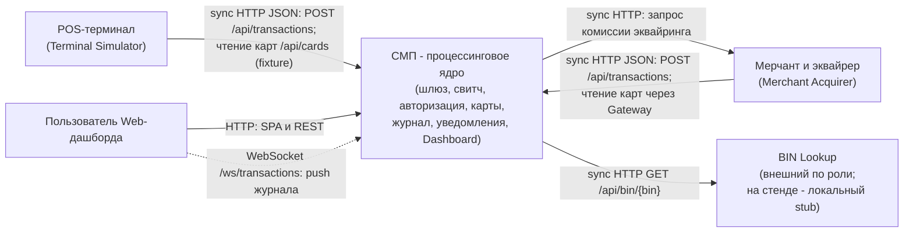

# А1. C4 Context - граница СМП и внешние участники

**Не было указано:** отдельная карта границ СМП, отделяющая систему от внешних акторов - не было явно показано, кто
находится снаружи системы и по какому протоколу к ней обращается.

**Что добавлено:**

- СМП выделена как единое процессинговое ядро. Симуляторы (Terminal, Merchant) и BIN Lookup отрисованы как **внешние
  зависимости**, хотя на стенде все они развёрнуты тем же`docker-compose`.
- Перечислены четыре внешних актора и протоколы их входа: **Terminal Simulator** (HTTP POST `/api/transactions`),
  **Merchant Simulator** (HTTP POST `/api/simulator/merchant/run`), **пользователь Web-дашборда**
  (REST через Gateway + WebSocket к Logger), **внешний BIN Lookup** (исходящий HTTP GET `/api/bin/{bin}`).

**Область тестирования:** граница контекста задаёт область проверок: сквозной сценарий запускает платёж через вход
Gateway, а внешний справочник BIN заменяется управляемым HTTP-моком. Обращения к реальным банкам и платёжным сетям в 
область тестирования не входят. Terminal и Merchant Simulator эмулируют поведение.

Сплошная стрелка - синхронный HTTP-запрос с ожиданием ответа; пунктир - асинхронный push по WebSocket.
HTTP-адреса соответствуют конфигурации локального стенда, TLS не предусмотрен.
RabbitMQ содержится внутри СМП-контекста, его связи описаны подробнее в [A2](A2_container.md)
и [A5](A5_rabbitmq_topology.md).

## Подтверждение в коде

- [GatewayClient.java](../../../services/terminal-simulator/src/main/java/com/processing/terminalsimulator/client/GatewayClient.java) -
  терминал отправляет транзакции и читает карты из CMS для фикстур.
- [GatewayClient.java](../../../services/merchant-acquirer/src/main/java/com/processing/merchantacquirer/client/GatewayClient.java) -
  мерчант шлёт транзакции и читает карты через Gateway.
- [MerchantAcquirerClient.java](../../../services/switch/src/main/java/com/processing/service/MerchantAcquirerClient.java) -
  обратный HTTP-запрос комиссии эквайринга из Switch.
- [nginx.conf](../../../services/dashboard/nginx.conf)
  и [useWebSocket.ts](../../../services/dashboard/src/hooks/useWebSocket.ts) - проксирование SPA/API и подписка на поток
  `/ws/transactions`.
- [BinLookupClient.java](../../../services/authorization/src/main/java/com/processing/authorization/client/BinLookupClient.java)
  и [BinLookupController.java](../../../services/bin-lookup/src/main/java/com/processing/binlookup/controller/BinLookupController.java) -
  HTTP-резолв BIN в issuerId; на стенде это локальная статическая таблица, обращений в реальный банковский
  интернет-сервис нет.
- [docker-compose.yaml](../../../docker-compose.yaml) - физическое развёртывание всех участников стенда.
