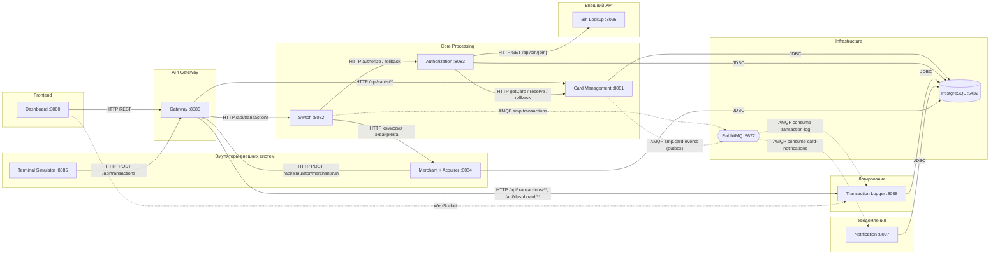

# А2. C4 Container - сервисы СМП и разметка sync/async

**Не было указано:** существующая схема `docs/architecture-diagram.puml` не различает синхронные и асинхронные
связи - все стрелки выглядят одинаково, async-пути (outbox, publisher confirms) не отражены, а состав сервисов
не был сверен с `docker-compose.yaml`.

**Что добавлено:**

- Перечислены runtime-сервисы по `docker-compose.yaml`, прикладные и инфраструктурные модули (за исключением `common` -
  библиотека, `e2e-tests` - тестовый модуль), PostgreSQL и RabbitMQ.
- Каждая связь размечена: сплошная линия - синхронный вызов (HTTP/JDBC), пунктир - асинхронный (AMQP) с именем
  exchange/queue.
- Явно показаны async-пути: `Switch -> RabbitMQ -> Logger` (publisher confirms) и
  `Card-Management (outbox) -> RabbitMQ -> Notification`.

**Область тестирования:** контейнерный уровень задаёт границы API- и интеграционных проверок. Синхронные связи
(Gateway -> Switch -> Authorization -> CMS/BIN) проверяются через соблюдение контрактов запрос-ответ;
асинхронные (Switch -> Logger, outbox -> Notification) - интеграционными тестами с очередью и БД. PostgreSQL у сервисов
общий, но взаимодействие между ними идёт только через API и AMQP, а не напрямую через таблицы.

Сплошная стрелка - синхронный вызов (HTTP или JDBC), проверяется API-тестом; пунктир - асинхронная
публикация/потребление по AMQP, проверяется интеграционным тестом. Детальная топология очередей раскрыта
в [A5](A5_rabbitmq_topology.md), внутреннее устройство сервисов - в [A3](A3_component.md).

## Подтверждение в коде

- [application.yml](../../../services/gateway/src/main/resources/application.yml) - маршруты Gateway (
  `/api/transactions`, `/api/cards/**`, `/api/dashboard/**`).
- [AuthorizationClient.java](../../../services/switch/src/main/java/com/processing/service/AuthorizationClient.java) -
  синхронный HTTP-клиент Switch -> Authorization (authorize/rollback).
- [CardManagementClientImpl.java](../../../services/authorization/src/main/java/com/processing/authorization/client/CardManagementClientImpl.java)
  и [BinLookupClient.java](../../../services/authorization/src/main/java/com/processing/authorization/client/BinLookupClient.java) -
  HTTP-клиенты Authorization к CMS и BIN.
- [RabbitMQConfig.java](../../../services/switch/src/main/java/com/processing/config/RabbitMQConfig.java)
  и [LoggerClient.java](../../../services/switch/src/main/java/com/processing/service/LoggerClient.java) - async-ветка
  Switch -> Logger (publisher confirms).
- [RabbitMQConfig.java](../../../services/card-management/src/main/java/com/processing/cardmanagement/config/RabbitMQConfig.java)
  и [CardEventListener.java](../../../services/notification-service/src/main/java/com/processing/notification/listener/CardEventListener.java) -
  async-ветка outbox -> Notification.
- [LimitUsageRepository.java](../../../services/authorization/src/main/java/com/processing/authorization/repositories/LimitUsageRepository.java)
  и репозитории `card-management`/`transaction-logger` - JDBC-связи сервисов с PostgreSQL.
- [application.yml](../../../services/switch/src/main/resources/application.yml) - `publisher-confirm-type: correlated`.
- [docker-compose.yaml](../../../docker-compose.yaml) - состав и порты всех сервисов стенда.
