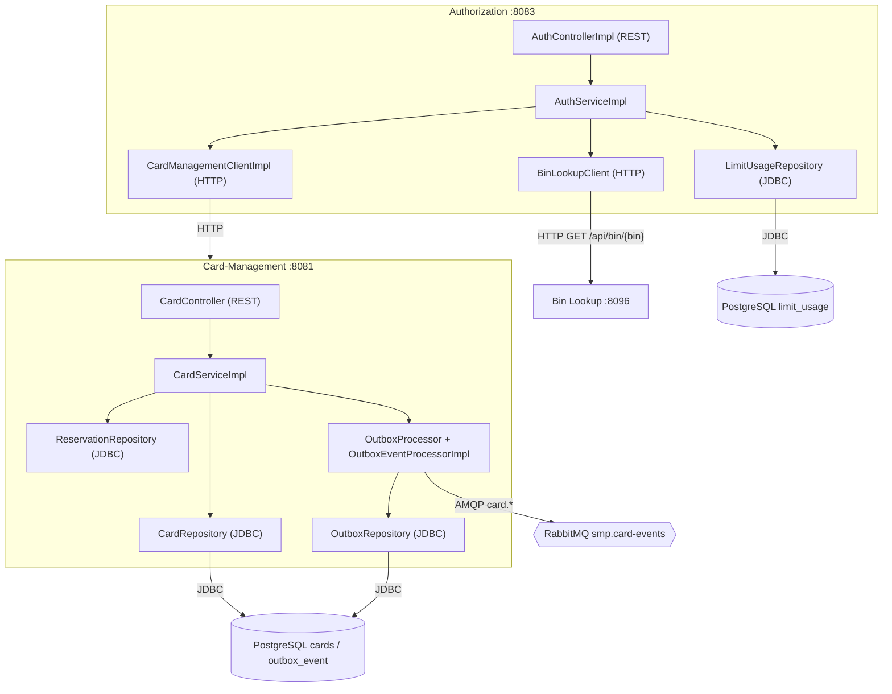

# А3. C4 Component - внутреннее устройство Authorization и Card-Management

**Не было указано:** компонентного уровня (Level 3) в проекте нет - документация ограничивается Container-уровнем, схемы
«что внутри сервиса» отсутствуют.

**Что добавлено:**

- Раскрыта внутренняя структура Authorization: `AuthControllerImpl -> AuthServiceImpl -> CardManagementClientImpl /
  BinLookupClient / LimitUsageRepository`
- Раскрыта внутренняя структура Card-Management: `CardController / CardGeneratorController / BinIssuerController ->
  CardServiceImpl -> CardRepository / ReservationRepository + OutboxEventProcessorImpl`
- Показано место асинхронной публикации: outbox сохраняет событие в `outbox_event` и публикует его в очередь
  независимо от синхронного ответа клиенту

**Область тестирования:** компонентный уровень - это карта для unit-тестов. Чистая логика (AuthServiceImpl,
CardServiceImpl, outbox) тестируется с подменой HTTP-клиентов и репозиториев на mock/stub; реальные JDBC-зависимости 
выносятся в интеграционные тесты с контейнером PostgreSQL. Outbox проверяется и изолированно (retry/FAILED), и по 
цепочке до уведомления.

HTTP-клиенты (ACLI, BCLI) в unit-тесте заменяются заглушками; JDBC-репозитории - реальная зависимость (интеграция);
outbox - отдельный компонент, тестируется изолированно и в цепочке. Связи между сервисами и AMQP-ветки видны на
контейнерном уровне [A2](A2_container.md).

## Подтверждение в коде

- [AuthControllerImpl.java](../../../services/authorization/src/main/java/com/processing/authorization/controller/AuthControllerImpl.java) -
  HTTP-вход Authorization (`/api/internal/authorize`, `/api/internal/rollback`).
- [AuthServiceImpl.java](../../../services/authorization/src/main/java/com/processing/authorization/services/AuthServiceImpl.java)
  и [DeclineOutcome.java](../../../services/authorization/src/main/java/com/processing/authorization/constants/DeclineOutcome.java) -
  бизнес-логика авторизации и ветки отказов.
- [CardManagementClientImpl.java](../../../services/authorization/src/main/java/com/processing/authorization/client/CardManagementClientImpl.java)
  и [BinLookupClient.java](../../../services/authorization/src/main/java/com/processing/authorization/client/BinLookupClient.java) -
  HTTP-клиенты к CMS и BIN.
- [LimitUsageRepository.java](../../../services/authorization/src/main/java/com/processing/authorization/repositories/LimitUsageRepository.java) -
  JDBC-работа с `limit_usage`.
- [CardController.java](../../../services/card-management/src/main/java/com/processing/cardmanagement/controllers/CardController.java) -
  HTTP-вход Card-Management (`/api/cards/**`).
- [CardServiceImpl.java](../../../services/card-management/src/main/java/com/processing/cardmanagement/services/CardServiceImpl.java) -
  бизнес-логика карт и резервирований.
- [CardRepository.java](../../../services/card-management/src/main/java/com/processing/cardmanagement/repositories/CardRepository.java)
  и [ReservationRepository.java](../../../services/card-management/src/main/java/com/processing/cardmanagement/repositories/ReservationRepository.java) -
  JDBC-репозитории карт и резервов.
- [OutboxEventProcessorImpl.java](../../../services/card-management/src/main/java/com/processing/cardmanagement/services/OutboxEventProcessorImpl.java)
  и [OutboxRepository.java](../../../services/card-management/src/main/java/com/processing/cardmanagement/repositories/OutboxRepository.java) -
  outbox-публикация и чтение `outbox_event`.
- [PanGenerator.java](../../../services/card-management/src/main/java/com/processing/cardmanagement/services/PanGenerator.java)
  и [LuhnValidator.java](../../../services/card-management/src/main/java/com/processing/cardmanagement/services/LuhnValidator.java) -
  генерация PAN и проверка контрольной цифры.
