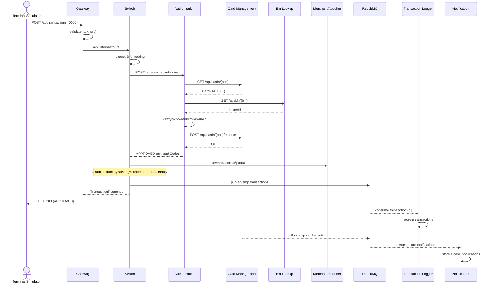
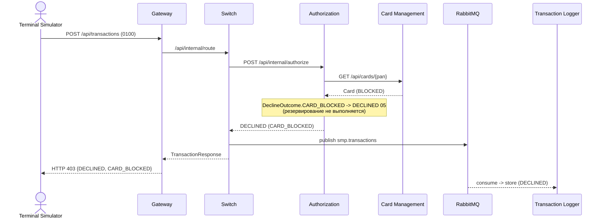
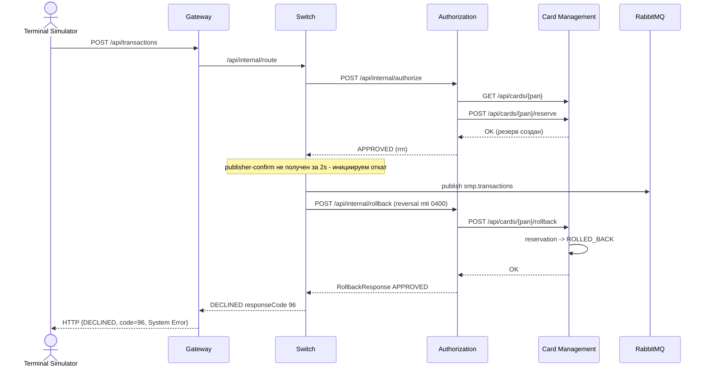

# А4. Sequence - путь транзакции (happy path, declined, reversal)

**Не было указано:** mermaid-sequence в `docs/architecture.md` покрывает только happy path; declined
и reversal отсутствуют, хотя в коде есть и все ветки отказов в `DeclineOutcome`, и`publisherConfirmType=CORRELATED` 
с откатом резервирования.

**Что добавлено:**

- Три сценария: happy path, declined (карта BLOCKED) и reversal (mti 0400)
- Помечено, где проходит синхронная цепочка (HTTP), а где после ответа клиенту начинается асинхронная цепочка (AMQP)

**Область тестирования:** последовательность задаёт сквозные и интеграционные сценарии. Happy path и declined
проверяются на полном контуре (E2E); reversal (0400) - интеграционным тестом на недоставку сообщения в очередь.
Eventual consistency проверяется отложенно: запись в Logger появляется не в момент ответа, а позже.

### Сценарий 1 - Happy path (одобрено)

### Сценарий 2 - Declined (карта BLOCKED)

### Сценарий 3 - Reversal (mti 0400): publisher-confirm не получен за 2s

Сплошная стрелка - синхронный HTTP-вызов с ответом; пунктир - асинхронное сообщение по AMQP. Топология очередей
и механика retry/DLQ раскрыты в [A5](A5_rabbitmq_topology.md), статусы карты и транзакции -
в [A6](A6_state_transition.md).

## Подтверждение в коде

- [RouteService.java](../../../services/switch/src/main/java/com/processing/service/RouteService.java) - оркестрация
  `route()`: BIN -> authorize -> tryLog -> rollback при `!logged && APPROVED`.
- [AuthorizationClient.java](../../../services/switch/src/main/java/com/processing/service/AuthorizationClient.java) -
  HTTP-клиент Switch -> Authorization (authorize/rollback, resilience).
- [LoggerClient.java](../../../services/switch/src/main/java/com/processing/service/LoggerClient.java)
  и [application.yml](../../../services/switch/src/main/resources/application.yml) - публикация с publisher confirms.
- [AuthServiceImpl.java](../../../services/authorization/src/main/java/com/processing/authorization/services/AuthServiceImpl.java)
  и [DeclineOutcome.java](../../../services/authorization/src/main/java/com/processing/authorization/constants/DeclineOutcome.java) -
  ветки отказов при авторизации и rollback.
- [CardServiceImpl.java](../../../services/card-management/src/main/java/com/processing/cardmanagement/services/CardServiceImpl.java) -
  резервирование и откат (`reserve`, `rollback`).
- [TransactionLogListener.java](../../../services/transaction-logger/src/main/java/com/processing/transactionlogger/listener/TransactionLogListener.java) -
  async-потребление и сохранение в `transactions`.