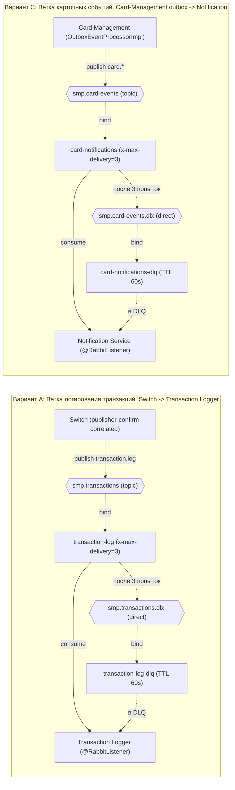

# А5. RabbitMQ-топология - exchange, queue, consumer, DLX/DLQ

**Не было указано:** топология в `docs/architecture.md` описана таблицей и текстом, но не визуализирована -
нет схемы, где полностью виден путь сообщения и точки отказа (DLX/DLQ).

**Что добавлено:**

- Обе async-ветки: Switch -> Logger (Вариант A: Ветка логирования транзакций) и Card-Management outbox -> Notification (
  Вариант C: Ветка карточных событий).
- Путь exchange -> queue -> consumer, routing key, DLX/DLQ, retry (`x-max-delivery=3`), TTL DLQ (60s),
  publisher confirms (2s).

**Область тестирования:** топология задаёт область интеграционных проверок асинхронных путей: доставка сообщения
до подписчика, retry (3 попытки), попадание в DLQ после исчерпания попыток, publisher confirms (2s) и откат
резервирования (reversal, код 96) при недоставке.

Retry - 3 попытки (`x-max-delivery`), после чего сообщение уходит в DLQ с TTL 60s. Publisher confirms: Switch ждёт
подтверждение брокера 2s, при недоставке инициирует reversal (mti 0400) и возвращает DECLINED 96. Outbox-паттерн:
событие сначала пишется в `outbox_event` (PENDING), публикуется и переводится в PROCESSED/FAILED. Место веток в
общей картине - в [A2](A2_container.md), поведение при недоставке - в [A4](A4_sequence.md).

## Подтверждение в коде

- [RabbitMQConfig.java](../../../services/switch/src/main/java/com/processing/config/RabbitMQConfig.java)
  и [RabbitMQConfig.java](../../../services/transaction-logger/src/main/java/com/processing/transactionlogger/config/RabbitMQConfig.java) -
  топология `smp.transactions`, `transaction-log`, DLX/DLQ.
- [RabbitMQConfig.java](../../../services/card-management/src/main/java/com/processing/cardmanagement/config/RabbitMQConfig.java)
  и [RabbitMQConfig.java](../../../services/notification-service/src/main/java/com/processing/notification/config/RabbitMQConfig.java) -
  топология `smp.card-events`, `card-notifications`, DLX/DLQ.
- [OutboxEventProcessorImpl.java](../../../services/card-management/src/main/java/com/processing/cardmanagement/services/OutboxEventProcessorImpl.java)
  и [OutboxProcessor.java](../../../services/card-management/src/main/java/com/processing/cardmanagement/services/OutboxProcessor.java) -
  публикация из outbox, retry/FAILED.
- [application.yml](../../../services/switch/src/main/resources/application.yml) - `publisher-confirm-type: correlated`,
  `publisher-returns: true`.
- [CardEventListener.java](../../../services/notification-service/src/main/java/com/processing/notification/listener/CardEventListener.java) -
  потребление карточных событий и сохранение в `card_notifications`.
- [TransactionLogListener.java](../../../services/transaction-logger/src/main/java/com/processing/transactionlogger/listener/TransactionLogListener.java) -
  потребление транзакций и сохранение в `transactions`.
