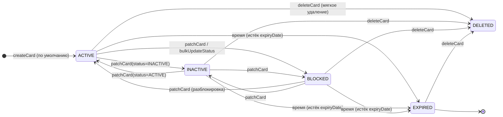
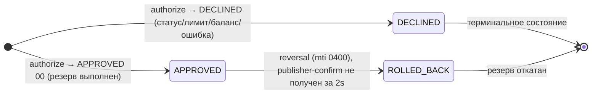

# А6. State-transition - статусы Card и жизненный цикл Transaction

**Не было указано:** state-диаграмм в проекте нет - есть только enum `CardStatus` и логика
`authorize()/reserve()/rollback()`, из которых переходы нужно выводить вручную.

**Что добавлено:**

- Диаграмма состояний `Card.status` (ACTIVE/INACTIVE/BLOCKED/EXPIRED/DELETED).
- Жизненный цикл Transaction (APPROVED/DECLINED/ROLLED_BACK через reversal).
- Каждый переход обоснован операцией в коде (create/patch/delete/время/reversal).

**Область тестирования:** изменения состояния порождают проверки валидности переходов. Смена статуса карты через PATCH 
и истечение срока (код 54) проверяются API/интеграционными тестами с состоянием БД; откат резервирования (reversal) -
интеграционным тестом на недоставку в очередь. Каждый переход - отдельный тест-кейс.

### Статусы карты

### Жизненный цикл транзакции

EXPIRED наступает «по времени» (expiryDate) и выявляется в `AuthServiceImpl.authorize` (код 54); DELETED - мягкое
удаление. В enum `TransactionStatus` только APPROVED/DECLINED; состояние ROLLED_BACK отражает откат резервирования
(`Reservation.rolledBack` + `ReservationRollback` в Card-Management). Место переходов в транзакции - в [A4](A4_sequence.md).

## Подтверждение в коде

- [CardStatus.java](../../../services/card-management/src/main/java/com/processing/cardmanagement/models/CardStatus.java) -
  перечень статусов карты (ACTIVE/INACTIVE/BLOCKED/EXPIRED/DELETED).
- [CardServiceImpl.java](../../../services/card-management/src/main/java/com/processing/cardmanagement/services/CardServiceImpl.java) -
  `createCard` (→ACTIVE), `patchCard`/`bulkUpdateStatus` (смена статуса), `deleteCard` (→DELETED), `rollback`.
- [AuthServiceImpl.java](../../../services/authorization/src/main/java/com/processing/authorization/services/AuthServiceImpl.java) -
  проверка статуса и `expiryDate` при авторизации (код 54).
- [TransactionStatus.java](../../../services/common/src/main/java/com/processing/common/dto/transactionlogger/TransactionStatus.java) -
  статусы транзакции (APPROVED/DECLINED).
- [RouteService.java](../../../services/switch/src/main/java/com/processing/service/RouteService.java) -
  инициация reversal при недоставке в очередь.
